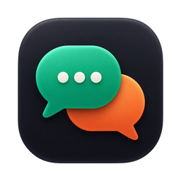
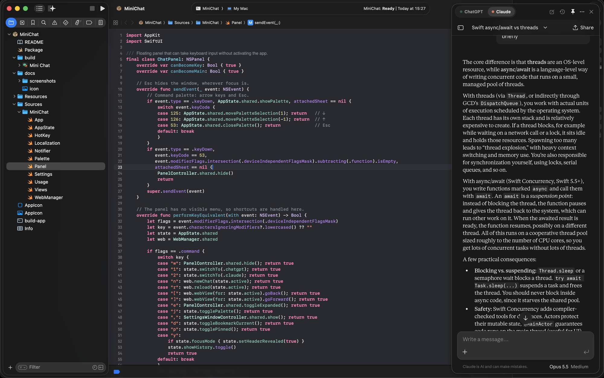
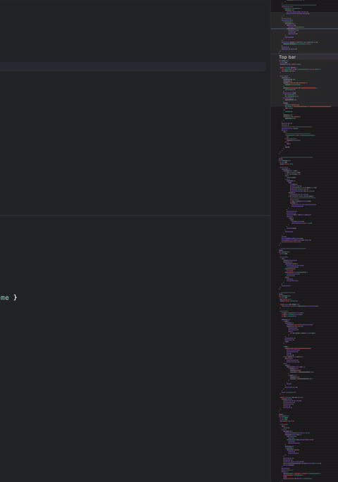
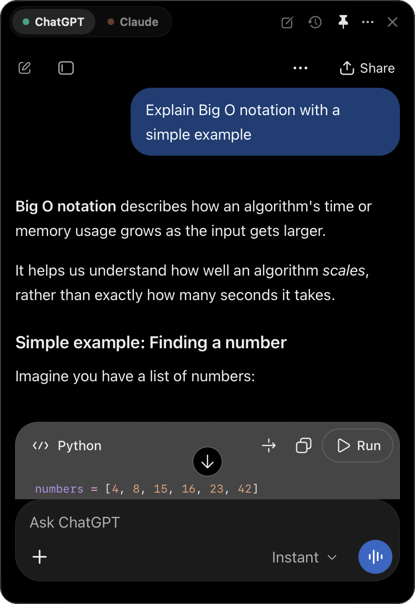
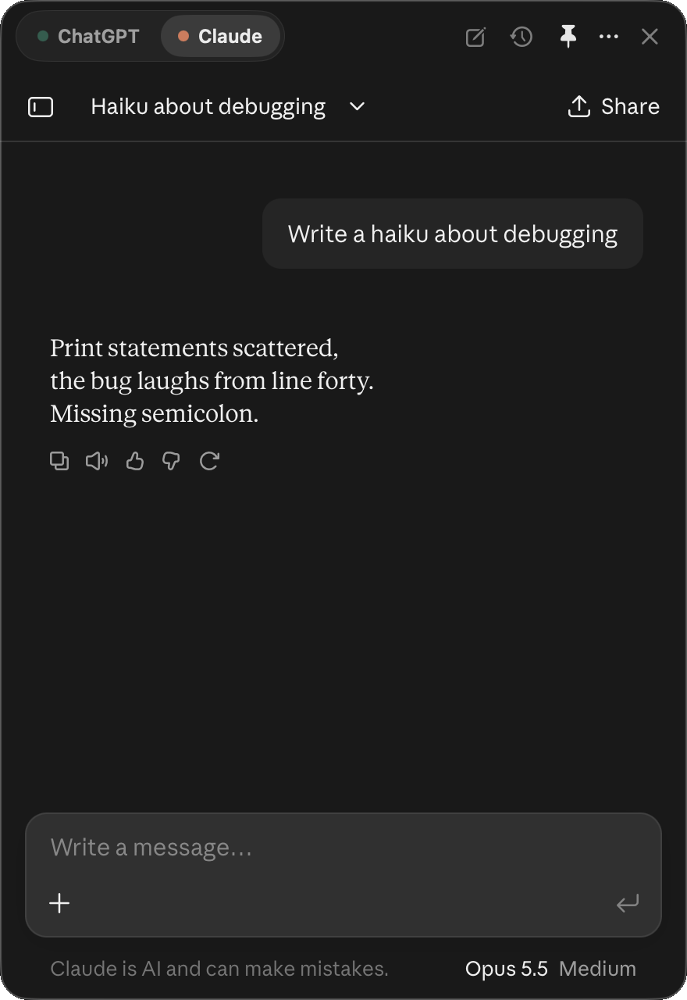
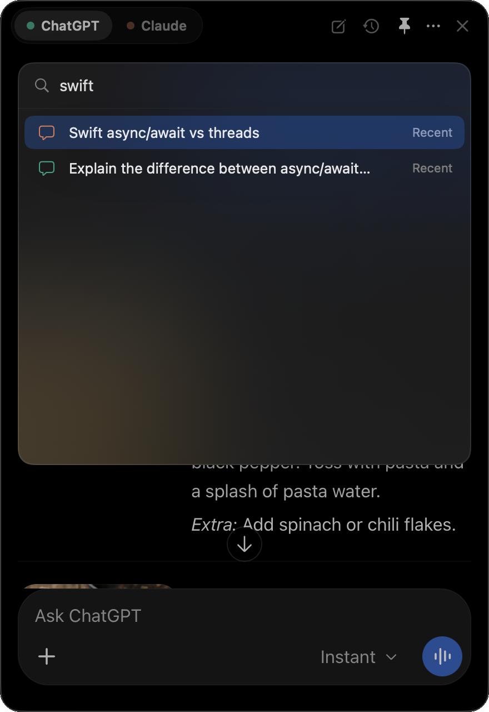
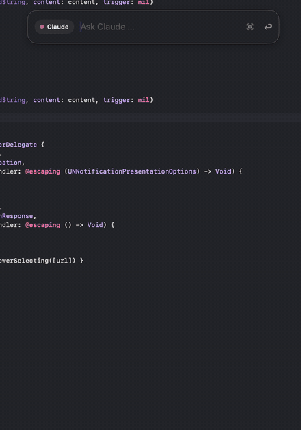
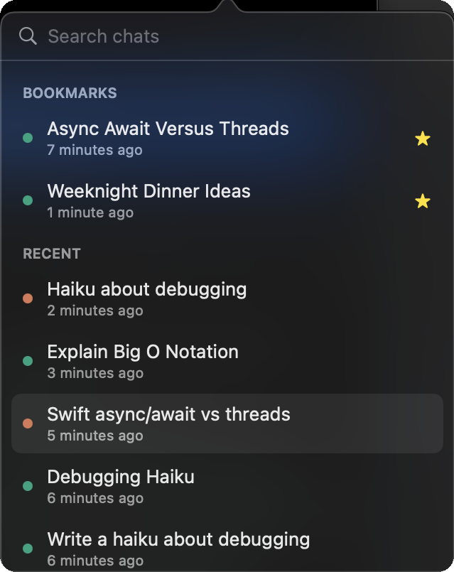
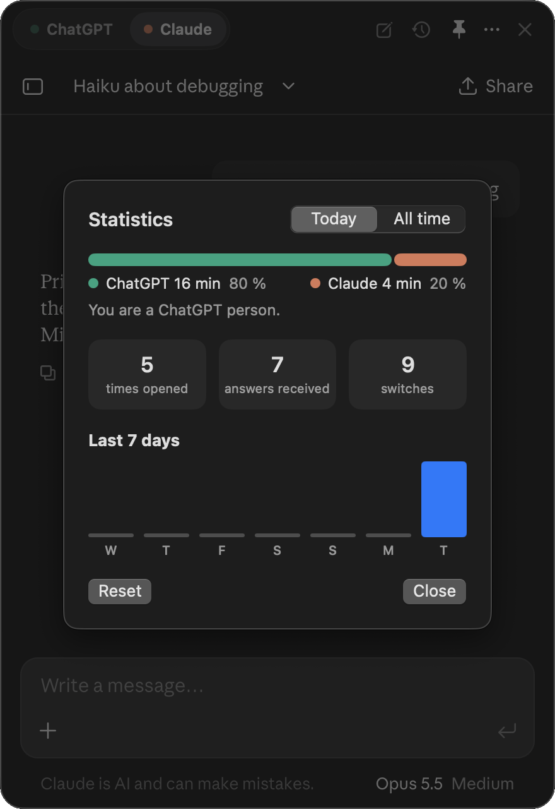
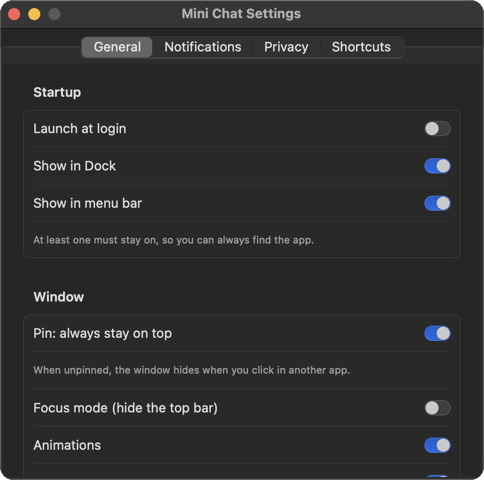

<p align="center">
  
</p>

<h1 align="center">Mini Chat</h1>

<p align="center">
  A floating ChatGPT and Claude window for macOS, one keystroke away.
</p>

<p align="center">
  
  
  
  
</p>

<p align="center">
  
</p>

---

## The problem

The original ChatGPT desktop app for macOS had a small but very useful feature: press **Option+Space** and a compact chat window appears on top of whatever you are doing. The whole conversation stays inside that little window, and it disappears just as quickly when you are done.

That app is being retired. The in-app notice says it will be discontinued on January 30, 2027, and the replacement app does not have the same floating window.

The alternatives fall short in different ways:

- **Claude's desktop app** has a quick-entry shortcut, but as soon as you ask something, the conversation moves to the main window.
- **A browser tab** works, but you have to find it, it is never on top, and it is easy to lose among other tabs.
- **API-based clients** keep the conversation in a small window, but they need separate API billing on top of the subscription you already pay for, and your chat history does not sync with your account.

## The solution

Mini Chat is a native macOS app that recreates the floating chat window and goes a few steps further:

<p align="center">
  
</p>

- **One shortcut, always there.** Option+Space shows and hides a floating panel above every app and every Space, including full-screen apps.
- **Your real accounts.** The panel shows chatgpt.com and claude.ai directly, so you sign in with the subscriptions you already have. No API keys, no extra cost, and your full chat history stays in sync.
- **Both assistants in one place.** A switcher at the top moves between ChatGPT and Claude instantly. Both pages stay loaded in the background, so each conversation is exactly where you left it.
- **Built for macOS.** Native window management, notifications, Dock and menu bar integration, and keyboard shortcuts for everything.

## Features

<p align="center">
  
  &nbsp;
  
  &nbsp;
  
</p>

### Quick bar

<p align="center">
  
</p>

After a break, ⌥Space opens a small quick bar instead of the previous chat. Type a question and press Return: the bar grows into the full window and the question is sent in a new chat. Press Tab to switch between ChatGPT and Claude, and ⌘Return to open the previous chat instead. Attach files and images by pasting them (⌘V), dragging them onto the bar, or taking a screenshot (⌘⇧S). The break length is adjustable in Settings, or the bar can be turned off.

### Window

- Floating panel that opens with **⌥Space** and hides with **Esc**
- **Quick bar** after a break: ⌥Space opens a small input line, Return sends the question and the bar grows into the full window (adjustable, or off). Attach files and images by pasting (⌘V), dragging them onto the bar, or taking a screenshot (⌘⇧S)
- **Peek mode** (**⌥⇧Space**): show the window without taking the keyboard from the app you are working in
- **Pin**: keep the window on top, or let it hide when you click somewhere else
- **Expand** to a large window with **⌘E** or a double-click on the top bar
- **Snap** to the left or right screen edge, or the center (**⌃⌥←**, **⌃⌥→**, **⌃⌥↑**)
- **Focus mode** (**⌘⇧F**): the top bar slides away and comes back when you move the mouse to the top edge
- The top bar matches the color of the page, so the window reads as one surface

### Getting around

- **Command palette** (**⌘J**): search every command, bookmark and recent chat from one field
- **Recent chats and bookmarks** (**⌘Y**) across both services, with search, renaming and bookmarks (**⌘D**)
- Links to other sites open in your default browser, and files the assistants create are saved to Downloads

### While you wait

- A **notification** and a **Dock badge** when an answer finishes while the window is hidden
- A **pulsing menu bar icon** and a **timer** in the switcher while an answer is being written
- An optional **sound** when an answer is done

### Privacy

- **Hide the chat** (**⌘⇧H**) behind a neutral cover, for example when sharing your screen
- History and usage statistics are stored only on your Mac and can be turned off or cleared

### Just for fun

- **Usage statistics**: time spent in each service, answers received, a seven-day chart, a streak counter and a verdict on whether you are a ChatGPT person or a Claude person

<p align="center">
  
  &nbsp;
  
</p>

### Settings

<p align="center">
  
</p>

A settings window (**⌘,**) lets you turn every feature on or off: launch at login, Dock and menu bar visibility, animations, notifications, sounds, history and statistics.

## How it works

Mini Chat is written in Swift with SwiftUI for the interface and AppKit for the parts SwiftUI cannot do on its own.

| Part | Approach |
|---|---|
| Floating window | A borderless, non-activating `NSPanel` at floating level that joins all Spaces. It can take keyboard input without stealing focus from your other apps. |
| Global shortcut | Carbon `RegisterEventHotKey`, which needs no Accessibility permission. |
| Chat pages | One persistent `WKWebView` per service with a shared, persistent data store, so you stay signed in. |
| Matching colors | A tiny snapshot of the top strip of the page. The most common pixel color becomes the top bar color, which works regardless of how the site writes its CSS. |
| "Answer finished" | A small injected script checks for the stop button every half second and reports changes through a `WKScriptMessageHandler`. |
| History | Conversation URLs and titles are observed with KVO and stored locally as JSON. |
| Downloads | `WKDownload` saves generated files to `~/Downloads`. |
| Localization | Follows the system language. English and Norwegian Bokmål are included. |

### Design principles

1. **Prefer native over the DOM.** Anything that depends on the internal structure of chatgpt.com or claude.ai can break when they update their sites. Most features are built purely on the macOS side, and the few that read the page (answer detection) fail quietly.
2. **No extra accounts or keys.** The app uses the sessions you already have.
3. **Nothing leaves your Mac** except your normal traffic to OpenAI and Anthropic.

## Installation

Mini Chat is built from source. You need **macOS 14 (Sonoma) or later** and **Xcode** (or the Command Line Tools: `xcode-select --install`).

```bash
git clone https://github.com/jonesstoen/MiniChat.git
cd MiniChat
bash build-app.sh --install
```

The script builds the app, copies it to `/Applications` and launches it. On first launch, the window opens so you can sign in to ChatGPT and Claude. Your sessions are remembered after that.

To build without installing, run `bash build-app.sh`. The app ends up in `build/Mini Chat.app`.

> If the old ChatGPT app is running, it still owns Option+Space. Quit it before starting Mini Chat.

## Keyboard shortcuts

| Shortcut | Action |
|---|---|
| ⌥Space | Show / hide the window (works everywhere) |
| ⌥⇧Space | Peek: show without taking the keyboard |
| Tab / ⌘Return (quick bar) | Switch service / open the previous chat |
| ⌘V / ⌘⇧S (quick bar) | Attach a copied file or image / take a screenshot |
| ⌘J | Command palette |
| ⌘1 / ⌘2 or Ctrl+Tab | ChatGPT / Claude |
| ⌘N | New chat |
| ⌘Y | Recent chats and bookmarks |
| ⌘D | Bookmark the current chat |
| ⌘E or double-click the top bar | Expand / shrink |
| ⌃⌥← / ⌃⌥→ / ⌃⌥↑ | Snap left / right / center |
| ⌘P | Pin on / off |
| ⌘⇧F | Focus mode |
| ⌘⇧H | Hide / show the chat |
| ⌘R | Reload |
| ⌘[ / ⌘] | Back / forward |
| ⌘, | Settings |
| Esc or ⌘W | Hide the window |

## Known limitations

- **Answer detection depends on the sites.** Notifications, the pulsing icon and the timer look for the stop button on the page. If OpenAI or Anthropic change it, these features stop working until the detection is updated. The rest of the app is unaffected.
- **Signing in with Google** can be blocked in embedded browsers. Email or "Continue with Apple" usually works.
- **Not notarized.** The app is signed ad hoc when you build it yourself, so it is meant to be built locally rather than downloaded as a binary.

## Project structure

```
Sources/MiniChat/
├── App.swift            App entry, menu bar extra, global shortcuts
├── AppState.swift       Shared state, settings, history and bookmarks
├── Panel.swift          Floating panel, animations, snapping, keyboard handling
├── Views.swift          Top bar, switcher, history list, privacy cover
├── WebManager.swift     Web views, navigation, downloads, answer detection
├── Palette.swift        Command palette
├── Settings.swift       Settings window
├── Usage.swift          Usage statistics
├── Notifier.swift       Notifications
├── HotKey.swift         Carbon global hotkeys
└── Localization.swift   Translation helpers
Resources/
├── en.lproj/            English strings
└── nb.lproj/            Norwegian strings
```

## Disclaimer

Mini Chat is an independent project and is not affiliated with, endorsed by or sponsored by OpenAI or Anthropic. ChatGPT is a trademark of OpenAI. Claude is a trademark of Anthropic. Mini Chat only displays the official websites in a native window, and your use of those services is governed by their own terms.

## Author

Built by Johannes Støen, a computer science master's student at the University of Oslo.

[johannesstoen.no](https://johannesstoen.no) · [GitHub](https://github.com/jonesstoen)
